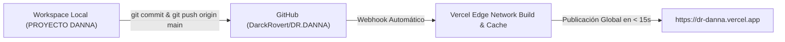

# Documentación Técnica de Arquitectura

## Portafolio Profesional — Dra. Danna Marjorie Tupac Rojas

- **Entorno de Producción:** [https://dr-danna.vercel.app](https://dr-danna.vercel.app)
- **Repositorio Oficial:** [GitHub: DarckRovert/DR.DANNA](https://github.com/DarckRovert/DR.DANNA)
- **Mecanismo de Despliegue:** CI/CD automático via Git Push en Vercel Edge Network
- **Stack Tecnológico:** HTML5 Semántico + CSS3 Vanilla (Tokens & Glassmorphism) + ES6+ Nativo

---

## 1. Filosofía de Arquitectura (Zero-Framework)

El proyecto prescinde intencionalmente de frameworks pesados (como React, Angular o Next.js) para maximizar la velocidad de carga, eliminar dependencias vulnerables en tiempo de ejecución y asegurar una compatibilidad del 100% en navegadores móviles y de escritorio.

### Métricas de Rendimiento Objetivas:
- **First Contentful Paint (FCP):** < 0.4s
- **Time to Interactive (TTI):** < 0.5s
- **Cumulative Layout Shift (CLS):** 0.00 (sin saltos de contenido)
- **Peso Total de la Página:** ~130 KB (código base minificado/comprimido)

---

## 2. Estructura de Directorios

```text
PROYECTO DANNA/
├── index.html                    # Árbol DOM semántico, metadatos OG/Twitter y JSON-LD
├── style.css                     # Sistema de tokens, maquetación Grid/Flex, media queries
├── app.js                        # Motor interactivo: Canvas HiDPI, IntersectionObserver, WhatsApp
├── assets/                       # Activos estáticos optimizados
│   ├── dra-danna-hero.jpg        # Retrato Hero (900x1530 px, JPEG optimizado)
│   ├── dra-danna-about.jpg       # Retrato Sobre Mí (900x1530 px, JPEG optimizado)
│   ├── dra-danna-clinical.jpg    # Retrato Formación Hospitalaria (900x1530 px, JPEG)
│   ├── dra-danna-consult.jpg     # Retrato Contacto en Consulta (900x1530 px, JPEG)
│   └── CV_Dra_Danna_Tupac.pdf    # Expediente curricular oficial de 12 folios (3.9 MB)
├── .gitignore                    # Exclusión de escaneos pesados locales (DRA. TUPAC CV.pdf)
├── README.md                     # Guía de usuario y mantenimiento
└── DOCUMENTATION.md              # Documentación técnica de referencia
```

---

## 3. Especificación del Frontend

### 3.1 Sistema de Diseño (`style.css`)
El archivo de estilos utiliza variables CSS nativas (`:root`) para garantizar consistencia cromática y facilitar futuras tematizaciones:

```css
:root {
  --navy:         #0a0f1e;    /* Fondo primario de alta seriedad clínica */
  --navy-2:       #0d1428;    /* Fondo alterno para contraste de secciones */
  --navy-3:       #111827;    /* Fondo oscuro para tarjetas y pie de página */
  --emerald:      #10b981;    /* Color de acento médico y de salud */
  --emerald-2:    #059669;    /* Tono profundo de interacción */
  --gold:         #f59e0b;    /* Color secundario de resalte (postgrado/CMP) */
  --white:        #f8fafc;    /* Tipografía principal */
  --muted:        #94a3b8;    /* Tipografía secundaria y descripciones */
  --border:       rgba(16,185,129,0.18);
  --glass:        rgba(255,255,255,0.04);
  --glass-border: rgba(255,255,255,0.08);
}
```

#### Tipografía y Justificación:
- **Títulos:** `Cormorant Garamond` (Google Fonts), serif clásica con estilo médico formal.
- **Cuerpo y Controles:** `Inter` (Google Fonts), sans-serif de alta legibilidad en pantallas reducidas.
- **Formato de Párrafos:** Todos los textos descriptivos (`.sobre-mi-text p`, `.hero-description`, `.contacto-intro`, `.timeline-content > p`, `.espec-card p`) implementan:
  ```css
  text-align: justify;
  text-justify: inter-word;
  ```
- **Uniformes en Sobre Mí:** Eliminada la discrepancia del lead-text; todos los párrafos de la reseña biográfica comparten `font-family: var(--font-sans)`, `font-size: 1rem` y `line-height: 1.8`.

#### Encuadre de la Fotografía Principal (Hero):
```css
.photo-frame {
  width: 350px;
  height: 480px;
  ...
}
.photo-frame img.hero-img {
  object-fit: cover;
  object-position: center 36%;
}
```
*Justificación técnica:* La coordenada `center 36%` sitúa el centro focal en el esternón, permitiendo visibilizar de forma nítida los brazos cruzados y la postura ejecutiva sin recortar el peinado superior.

---

## 4. Lógica Interactiva (`app.js`)

### 4.1 Lienzo de Partículas con Soporte HiDPI / Retina
Para evitar que las líneas y nodos del canvas se vean borrosos en pantallas 2K, 4K y dispositivos móviles, la inicialización compensa la densidad de píxeles:
```javascript
function resize() {
  const dpr = window.devicePixelRatio || 1;
  W = canvas.offsetWidth;
  H = canvas.offsetHeight;
  canvas.width = W * dpr;
  canvas.height = H * dpr;
  ctx.setTransform(dpr, 0, 0, dpr, 0, 0);
}
```

### 4.2 Animación de Estadísticas Resiliente y Preservación de Prefijos
El observador de contadores numéricos (`statsObserver`) aplica tres filtros de seguridad:
1. Omite elementos con el atributo `data-static="true"` (evitando mutaciones en códigos estáticos como `"111905"` o siglas como `"UPC"` y `"EPG"`).
2. Valida la existencia de dígitos (`\D/g`), previniendo errores de tipo `NaN`.
3. Detecta si el texto original iniciaba con `+` (ej. `+2`) para animar como prefijo (`+0`, `+1`, `+2`), preservando la convención de lectura en español.

### 4.3 Canalización Inteligente a WhatsApp
El formulario de contacto (`#contactForm`) captura los valores del visitante, construye un payload codificado con `encodeURIComponent` y activa la API de WhatsApp sin intermediarios ni servidores de correo:
```javascript
const textoWA = `Hola Dra. Danna Tupac,\n\nMi nombre es *${nombre}*.\nMotivo: ${motivo}\nMensaje: ${mensaje}\n\nContacto: ${email} ${telefono ? '| Tel: ' + telefono : ''}`;
const urlWA = `https://wa.me/51939753987?text=${encodeURIComponent(textoWA)}`;
```

---

## 5. SEO, Datos Estructurados y Validación Legal

### 5.1 Schema.org / Physician (JSON-LD)
Inyectado en la cabecera `<head>` para indexación en Google Search y Google Maps:
```json
{
  "@context": "https://schema.org",
  "@type": "Physician",
  "name": "Dra. Danna Marjorie Tupac Rojas",
  "medicalSpecialty": [
    "General Surgery",
    "Surgical Oncology",
    "Emergency Medicine",
    "Internal Medicine"
  ],
  "url": "https://dr-danna.vercel.app",
  "image": "https://dr-danna.vercel.app/assets/dra-danna-hero.jpg",
  "telephone": "+51939753987",
  "email": "tupacdanna@gmail.com",
  "address": {
    "@type": "PostalAddress",
    "streetAddress": "Jirón Monte Algarrobo 110, Urb. Monterrico Sur",
    "addressLocality": "Santiago de Surco",
    "addressRegion": "Lima",
    "addressCountry": "PE"
  },
  "alumniOf": {
    "@type": "EducationalOrganization",
    "name": "Universidad Peruana de Ciencias Aplicadas (UPC)"
  },
  "identifier": {
    "@type": "PropertyValue",
    "name": "Colegio Médico del Perú (CMP)",
    "value": "111905"
  }
}
```

### 5.2 Validador Oficial CMP
- **Endpoint Integrado:** `https://aplicaciones.cmp.org.pe/autenticidad-de-constancia/datos_constancia.php?codigo=20261030bd4c17dc9fcc`
- **Acreditación:** Colegiada Habilitada hasta el **31/12/2026**.

---

## 6. Pipeline de Despliegue Continuo (CI/CD)



Cualquier cambio empujado a la rama `main` activa la compilación estática y distribución global inmediata sin requerir configuración manual adicional.
